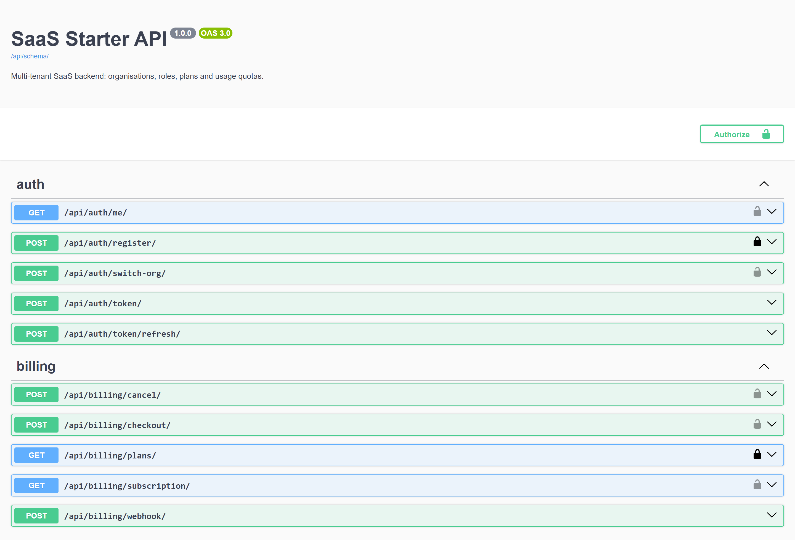

<div align="center">

# Django SaaS Starter

**Multi-tenant backend for subscription products: organisations, roles, plans, metered quotas and Stripe — ready to build on.**

Django 6 · DRF · JWT · OpenAPI

[](backend/pyproject.toml)
[](backend/pyproject.toml)
[](backend/tests)



</div>

---

## Why this exists

Most "SaaS boilerplates" stop at login. The parts that actually take time in a
real subscription product are the boring ones: **who belongs to which
organisation, what their role allows, and how many API calls the plan includes.**
This repository implements those three, and nothing else, so it stays readable.

## The tenancy model

```
User ──< Membership >── Organization ──1:1── Subscription ──> Plan
                             └──< UsageRecord (one row per month)
```

- A user can belong to **many** organisations with a different role in each.
- The active organisation lives **inside the JWT** as an `org_id` claim.
- Every protected view resolves `request.membership` from that claim.

That last point is the design decision worth copying: because the tenant is in the
token rather than the URL, a client cannot reach another organisation by editing a
path segment. Switching organisations means asking for a new token, and the server
only issues one if a membership actually exists.

| Role | Can do |
|---|---|
| `owner` | Everything, including cancelling the subscription. Cannot be removed. |
| `admin` | Invite and manage members, change plans. |
| `member` | Read the organisation, use metered endpoints. |

## Quotas

Every organisation has a plan with `monthly_api_calls` and `seats`. One module
decides whether work is allowed, so the rule cannot drift between endpoints:

```python
from billing import quota

state = quota.consume(organization)      # raises quota.QuotaExceeded when spent
```

`POST /api/orgs/report/` is a genuinely metered endpoint — it does real work and
spends one call. When the plan is exhausted it answers `402 Payment Required`
with `upgrade_required: true`, which is what the dashboard turns into an upgrade
prompt.

## Billing

`StripeProvider` is the real integration: it creates a Checkout session and lets
the webhook activate the subscription.

`FakeProvider` activates immediately and returns a local success URL. It is used
automatically when `STRIPE_SECRET_KEY` is not set, which means **the upgrade flow
is clickable on a fresh clone** — the state machine is exercised for real, only
the payment page is skipped.

## Quickstart

```bash
git clone https://github.com/MrFox2000/django-saas-starter
cd django-saas-starter/backend
python -m venv .venv
.venv/bin/pip install -e ".[dev]"

python manage.py migrate
python manage.py seed_demo          # demo@example.com / demo-pass-1234
python manage.py runserver 8002
```

- API docs: <http://127.0.0.1:8002/api/docs/>
- Admin: <http://127.0.0.1:8002/admin/> (create a superuser first)

`seed_demo` creates the **Acme Labs** organisation on the Starter plan with four
members (owner, admin, two members) and 342 used calls, so every screen has
something meaningful in it.

### With Postgres

```bash
docker compose up --build
```

The compose file runs Postgres 17 and applies migrations on boot.

## API

| Method | Path | Auth | Notes |
|---|---|---|---|
| `GET` | `/health/` | — | Liveness |
| `POST` | `/api/auth/register/` | — | Creates user **and** their first org |
| `POST` | `/api/auth/token/` | — | JWT with `org_id` claim |
| `POST` | `/api/auth/token/refresh/` | — | Rotating refresh |
| `GET` | `/api/auth/me/` | user | All memberships |
| `POST` | `/api/auth/switch-org/` | user | New token for another org |
| `GET/POST` | `/api/orgs/` | user | List mine / create |
| `GET` | `/api/orgs/current/` | org | Org, members, subscription, quota |
| `GET/POST` | `/api/orgs/members/` | org | List / invite (admin) |
| `PATCH/DELETE` | `/api/orgs/members/{id}/` | admin | Change role / remove |
| `POST` | `/api/orgs/report/` | org | **Metered** — spends one call |
| `GET` | `/api/billing/plans/` | — | Public price list |
| `GET` | `/api/billing/subscription/` | org | Subscription + quota + provider |
| `POST` | `/api/billing/checkout/` | admin | Starts checkout |
| `POST` | `/api/billing/cancel/` | owner | Cancels |
| `POST` | `/api/billing/webhook/` | — | Stripe callback |

## Tests

```bash
cd backend && python -m pytest
```

```
.............................                                            [100%]
```

Twenty-nine tests covering the claims this README makes:

- **auth** — registration creates org + ownership, duplicate email rejected,
  the token really carries `org_id`, `/me` requires a token
- **tenancy** — a member of one org gets `403` on another, switching reissues a
  scoped token, members cannot invite, admins can, the seat limit is enforced,
  the owner cannot be deleted
- **billing** — public plans, fake checkout activates the plan, upgrading lifts an
  exhausted quota, cancel changes status, webhook activation, `402` when spent

CI also runs `makemigrations --check` so a model change without a migration fails
the build.

## Design decisions

**Why a custom user model from day one?** Because switching later is a migration
nightmare, and every SaaS eventually wants email-only login.

**Why `402 Payment Required`?** It is the honest status. `429` means "slow down",
`403` means "never", while `402` says "this plan does not include that" — which is
exactly what an upgrade prompt needs to key off.

**Why keep the profile/tenant split rather than one `Account` model?** Because
users join multiple organisations and roles differ per organisation. A single
model forces a duplicate account per org and breaks invitations.

**Why is there no frontend here?** The Next.js dashboard is a separate repository
that consumes this API, so each can be read and deployed on its own.

## Limitations, stated plainly

- No email delivery: invitations are recorded, not emailed (console backend).
- No soft deletes or audit log.
- Usage resets per calendar month, no proration.
- The fake billing provider is for local demos only.

## Roadmap

- [ ] Email invitations with signed tokens
- [ ] Stripe customer portal instead of a custom cancel button
- [ ] Per-seat usage records
- [ ] Audit log on role changes

## License

MIT — see [LICENSE](LICENSE).
